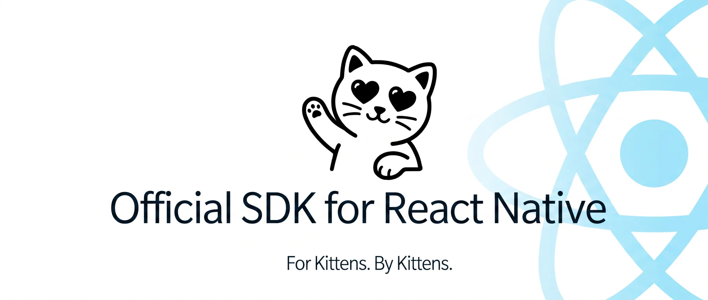
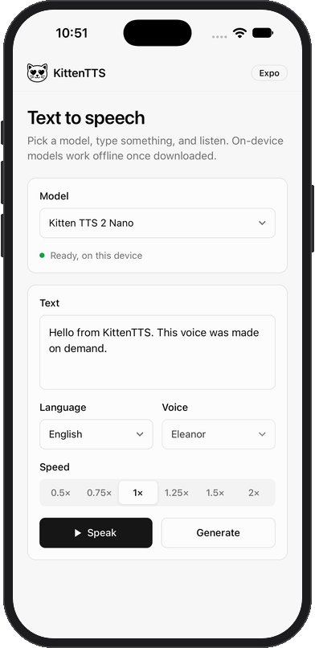
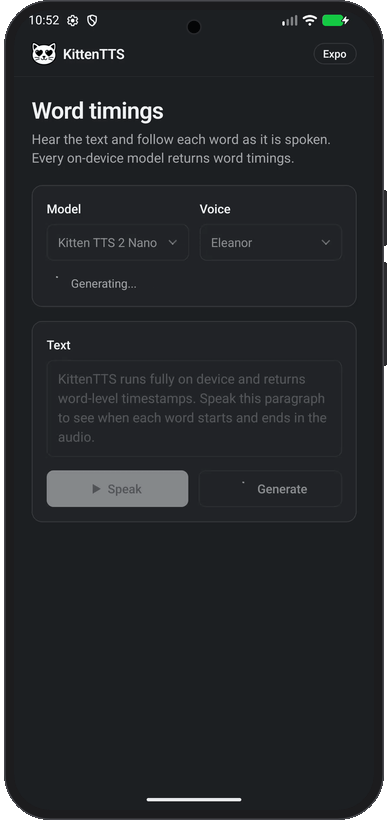

# KittenTTS React Native

<p align="center">
  
</p>

<p align="center">
  Kitten TTS 2 text-to-speech for React Native and React Native Web.
  <br />
  Nano, Pico and Mini run on the device on iOS, Android and the web; Kitten TTS 2 Cloud runs on the Kitten API.
</p>

<p align="center">
  <a href="https://huggingface.co/spaces/KittenML/KittenTTS-Demo"></a>
  <a href="https://discord.com/invite/VJ86W4SURW"></a>
  <a href="https://kittenml.com"></a>
  <a href="https://github.com/KittenML/kittentts-react-native"></a>
  <a href="LICENSE"></a>
  
</p>

> Developer preview. APIs may change between releases.

> Expo Go will not work for native iOS/Android. KittenTTS uses native modules
> (`onnxruntime-react-native` and `react-native-fs`) on mobile, so Expo apps
> need a development build or a prebuilt native project. Web builds use
> `onnxruntime-web` and browser storage instead.

> React Native Web loads a pinned ONNX Runtime Web script and WASM assets from
> jsDelivr by default. For production apps that need CDN independence or stricter
> supply-chain controls, self-host those ONNX Runtime assets and set
> `ortWasmPath`.

## See It In Action

<p align="center">
  
  
</p>

<p align="center">
  <strong>Device: iOS</strong> · Expo example &nbsp;&nbsp;&nbsp; <strong>Device: Android</strong> · Word timings
</p>

<p align="center">
  
</p>

<p align="center">
  <strong>Web</strong> · Browser example
</p>

---

## What Is KittenTTS React Native?

The React Native SDK for Kitten TTS. `KittenTTS.create()` picks the engine from
the model name, as the Python package does:

- **Kitten TTS 2 Nano, Pico and Mini, on the device** - 8 languages (Mini 16,
  Japanese included), int8 or int4 weights, word timings, and exactly the Python
  package's phonemes. Files download per language, or ship inside the app.
- **Kitten TTS 2 Cloud, on the Kitten API** - the largest Kitten TTS 2, with
  voice cloning, presets and 20+ languages. Nano, Pico and Mini run there too
  when you pass an API key.
- **Kitten TTS 0.8, on the device** - the older English models, still supported.

With the on-device models there is no cloud request, no API key and no text
leaving the device once the files are downloaded. The audio plays directly, or
comes back as samples, WAV data and word timings for read-aloud UI.

---

## SDK

| Runtime | Status | Docs |
| --- | --- | --- |
| React Native iOS | Developer preview | [Getting started](docs/getting-started.md) |
| React Native Android | Developer preview | [Getting started](docs/getting-started.md) |
| React Native Web | Developer preview | [Getting started](docs/getting-started.md#web) |
| Expo development build | Supported | [Expo setup](docs/getting-started.md#expo-development-build) |
| Expo Go | Not supported | [Why not?](docs/troubleshooting.md#expo-go-fails) |

Install:

```bash
npm install @kittentts/react-native
```

---

## Quick Start

Install the SDK:

```bash
npm install @kittentts/react-native
```

Generate a WAV in memory with Kitten TTS 2 Nano:

```tsx
import { KittenTTS } from '@kittentts/react-native';

const tts = await KittenTTS.create({ model: 'kitten-tts-2-nano' }, (progress) => {
  console.log(`setup ${Math.round(progress * 100)}%`);
});

const result = await tts.generate('Hello from Kitten TTS 2 on React Native.', { voice: 'Eleanor' });

console.log(result.duration);
console.log(result.wordTimings);
console.log(result.wavBase64());

await tts.dispose();
```

Play audio through Expo Audio:

```tsx
import * as ExpoAudio from 'expo-audio';
import { KittenTTS, createExpoAudioPlayer } from '@kittentts/react-native';

const tts = await KittenTTS.create({
  model: 'kitten-tts-2-nano',
  player: createExpoAudioPlayer(ExpoAudio),
});

await tts.speak('This voice is generated on the device.');
```

Play audio in a web build:

```tsx
import {
  KittenTTS,
  createBrowserAudioPlayer,
} from '@kittentts/react-native';

const tts = await KittenTTS.create({
  model: 'kitten-tts-2-nano',
  player: createBrowserAudioPlayer(),
});

await tts.speak('This voice is generated in the browser.');
```

### Other Languages

English, and Japanese on Mini, work as installed. German, French, Spanish,
Italian, Portuguese, Russian and Hindi (and Mini's Danish, Finnish, Dutch,
Swedish, Swahili, Turkish and Korean) go through espeak-ng, which is
GPL-3.0-or-later and comes in its own package, as in the Python package:

```bash
npm install @kittentts/espeak-ng
```

```tsx
import '@kittentts/espeak-ng'; // once, for example in the app's entry file
import { KittenTTS } from '@kittentts/react-native';

const tts = await KittenTTS.create({ model: 'kitten-tts-2-nano', languages: ['en', 'de'] });
await tts.generate('Guten Morgen.', { voice: 'Anna' }); // Anna is a German voice, so this is read as German
```

Without the import, those languages fail in `create()` or on first use with a
`MISSING_DEPENDENCY` error that names the package. An app that includes it ships
GPL-3.0 code; see [License](#license).

### Kitten TTS 0.8

The older English models load the same way:

```tsx
import { KittenModel, KittenTTS, KittenVoice } from '@kittentts/react-native';

const tts = await KittenTTS.create({ model: KittenModel.NanoInt8 });
await tts.generate('Hello from Kitten TTS 0.8.', KittenVoice.Luna);
```

With no `model` at all, `create()` still loads 0.8 Nano, as before.

[Full getting started guide →](docs/getting-started.md)

---

## Kitten TTS 2 Cloud

Kitten TTS 2 Cloud, the largest Kitten TTS 2, is too large to run inside an app,
so the SDK runs it on the hosted [Kitten API](https://docs.kittenml.com/). It
loads through the same `KittenTTS.create()` and answers the same calls, like
`KittenTTS("KittenML/kitten-tts-2")` in the Python package (`'kitten-tts-2'`
works here too):

```tsx
import * as ExpoAudio from 'expo-audio';
import { KittenTTS, createExpoAudioPlayer } from '@kittentts/react-native';

const tts = await KittenTTS.create({
  model: 'kitten-tts-2-cloud',
  apiKey: KITTENML_API_KEY, // ship with baseUrl and your own backend instead
  player: createExpoAudioPlayer(ExpoAudio),
});

await tts.speak('Hi! umm.. how are you, I guess?', 'bella_en');

const cloned = await tts.generate('This sentence uses my voice.', {
  reference: recordingUri,
  preset: 'stable',
});

for await (const chunk of tts.generateStreaming(longText, 'bella_en')) {
  await tts.play(chunk);
}
```

`tts.availableVoices` lists the voice IDs. The text you pass is sent to the API
and billed to your KittenML account. With an `apiKey` (or `baseUrl`), Nano, Pico
and Mini run on the API too: `KittenTTS.create({ model: 'kitten-tts-2-nano', apiKey })`.

[Kitten TTS 2 Cloud guide →](docs/guides/kitten-api.md)

---

## Expo Setup

Expo Go cannot load the native ONNX Runtime and filesystem modules used by this
SDK. Use a development build:

```bash
npm install @kittentts/react-native
npx expo install expo-audio expo-dev-client
npx expo prebuild
npx expo run:ios
```

For Android:

```bash
npx expo run:android
```

After the development build is installed:

```bash
npx expo start --dev-client
```

If the app opens in Expo Go, stop it and run `npx expo run:ios` or
`npx expo run:android` again.

---

## Sample Apps

- [`examples/ExpoExample`](examples/ExpoExample) - Expo (SDK 58) app with every
  engine: Kitten TTS 2 Nano, Pico and Mini on the device, the Kitten TTS 2 Cloud
  models, and the 0.8 models. Runs on iOS, Android and the web, and imports
  `@kittentts/espeak-ng` for every language.
- [`examples/BareRNExample`](examples/BareRNExample) - the same app in a bare
  React Native (0.81) project.
- [`examples/ExpoWordTimingsExample`](examples/ExpoWordTimingsExample) - word
  highlighting with generated timings, with Kitten TTS 2 or 0.8 on the device.
- [`examples/OfflineBundledAssetsExample`](examples/OfflineBundledAssetsExample) -
  Kitten TTS 2 Nano (English) and 0.8 Nano int8 shipped inside the app.

To run an example against this checkout of the SDK (or before a new version is on
npm), install it with `npm run example:install -- ExpoExample` from the
repository root. Until 2.0.0 and `@kittentts/espeak-ng` are on npm, set
`KITTENTTS_ESPEAK_NG_DIR` to a built checkout of `@kittentts/espeak-ng` to
install that too:
`KITTENTTS_ESPEAK_NG_DIR=../kittentts-espeak-ng npm run example:install -- ExpoExample`.

---

## Features

- [Kitten TTS 2 Nano, Pico and Mini](docs/guides/kitten-tts-2-tiny.md) on iOS, Android and the web, in 8 languages (Mini 16), with the Python package's phonemes.
- [Kitten TTS 2 Cloud](docs/guides/kitten-api.md) through the Kitten API, with voice cloning, and Nano, Pico and Mini in the cloud.
- [Kitten TTS 0.8](docs/reference/models.md#kitten-tts-08), the older English models, on the device.
- [Downloads per language](docs/guides/kitten-tts-2-tiny.md#what-gets-downloaded), cached on the device, with progress callbacks.
- [Bundled offline assets](docs/guides/offline-assets.md) for apps that cannot depend on a first-run download.
- [Expo development builds](docs/getting-started.md#expo-development-build); Expo Go is [not supported](docs/troubleshooting.md#expo-go-fails).
- [Playback helpers](docs/guides/playback.md) for Expo Audio, React Native Sound, and custom audio layers.
- [WAV output](docs/reference/api.md#kittenttsresult) as raw PCM samples, bytes, or base64.
- [Word timings](docs/guides/word-timings.md) for read-aloud highlighting.
- [Streaming generation](docs/guides/kitten-tts-2-tiny.md#usage) for longer text.

---

## Supported Models

### Kitten TTS 2

| Model | `model` | Parameters | int8 / int4 download | Languages |
| --- | --- | --- | --- | --- |
| Kitten TTS 2 Nano | `'kitten-tts-2-nano'` | 17M | 17 MB / 8.8 MB per language | 8 |
| Kitten TTS 2 Pico | `'kitten-tts-2-pico'` | 7.2M | 8 MB / 4 MB per language | 8 |
| Kitten TTS 2 Mini | `'kitten-tts-2-mini'` | 82M | 83 MB / 47 MB for every language | 16, Japanese included |
| Kitten TTS 2 Cloud | `'kitten-tts-2-cloud'` | 1.7B | nothing: it runs on the Kitten API | 20+, voice cloning |

Nano, Pico and Mini run on the device and need React Native 0.75 or newer
(Hermes). Nano is a good default; Pico is the fastest; Mini speaks the most
languages.

[Kitten TTS 2 Nano, Pico and Mini →](docs/guides/kitten-tts-2-tiny.md) (sizes,
languages, speed on real phones)

### Kitten TTS 0.8

The older English models, still supported:

| Model | Enum | Parameters | Approx download |
| --- | --- | --- | --- |
| Nano int8 | `KittenModel.NanoInt8` | 15M | 28 MB |
| Nano fp32 | `KittenModel.Nano` | 15M | 59 MB |
| Micro | `KittenModel.Micro` | 40M | 44 MB |
| Mini | `KittenModel.Mini` | 80M | 83 MB |

[Models and voices →](docs/reference/models.md)

## Voices

Kitten TTS 2 voices belong to a language: Nano has Eleanor, Martha, Otis and
others in English, Anna, Mia, Lukas and Paul in German, and so on. Pass a name,
in any case; the voice picks its language.

```tsx
tts.availableVoices;   // { en: ['Eleanor', ...], de: ['Anna', ...], ... }
await tts.speak('Eleanor speaking.', { voice: 'Eleanor' });
await tts.speak('Slower Otis speaking.', { voice: 'Otis', speed: 0.85 });
```

The eight `KittenVoice` names (Bella, Jasper, Luna, Bruno, Rosie, Hugo, Kiki,
Leo) belong to Kitten TTS 0.8:

```tsx
await tts08.speak('Luna speaking.', KittenVoice.Luna);
```

Kitten TTS 2 Cloud lists its own voice IDs, such as `bella_en`, in
`tts.availableVoices`.

---

## Docs

- [Docs overview](docs/README.md)
- [Getting started](docs/getting-started.md)
- [Kitten TTS 2 Nano, Pico and Mini](docs/guides/kitten-tts-2-tiny.md)
- [Kitten TTS 2 Cloud](docs/guides/kitten-api.md)
- [Playback](docs/guides/playback.md)
- [Word timings](docs/guides/word-timings.md)
- [Bundled offline assets](docs/guides/offline-assets.md)
- [Models and voices](docs/reference/models.md)
- [API reference](docs/reference/api.md)
- [Troubleshooting](docs/troubleshooting.md)

Tutorials:

- [Simple TTS app on macOS](docs/tutorials/simple-tts/mac.md)
- [Simple TTS app on Windows](docs/tutorials/simple-tts/windows.md)
- [Reader app on macOS](docs/tutorials/epub-reader/mac.md)
- [Reader app on Windows](docs/tutorials/epub-reader/windows.md)

---

## System Requirements

- React Native `>= 0.75` (Hermes) for Kitten TTS 2 Nano, Pico and Mini;
  `>= 0.72` for Kitten TTS 2 Cloud and the 0.8 models
- iOS `15.1+`
- Android API `24+`
- Node.js `20+` recommended for examples

Runtime dependencies installed by the SDK:

- `onnxruntime-react-native`
- `onnxruntime-web` (web builds)
- `react-native-fs`
- `pako`

Optional:

- `@kittentts/espeak-ng`, for the Kitten TTS 2 languages other than English and
  Japanese.
- Audio playback: `expo-audio`, `react-native-sound`, or a custom player.

---

## Roadmap

- Improve streaming and playback queue primitives.
- Add more reader-app helpers around pause, resume, and seek state.
- Continue tracking ONNX Runtime compatibility across React Native and Expo
  releases.
- Support future KittenTTS model releases as they become available.

Need something specific? [Open an issue](https://github.com/KittenML/kittentts-react-native/issues).

---

## Community And Support

- Website: [kittenml.com](https://kittenml.com/)
- Repository: [KittenML/kittentts-react-native](https://github.com/KittenML/kittentts-react-native)
- Discord: [Join the community](https://discord.com/invite/VJ86W4SURW)
- Demo: [Hugging Face Spaces](https://huggingface.co/spaces/KittenML/KittenTTS-Demo)
- Issues: [GitHub Issues](https://github.com/KittenML/kittentts-react-native/issues)
- Commercial support: [contact form](https://docs.google.com/forms/d/e/1FAIpQLSc49erSr7jmh3H2yeqH4oZyRRuXm0ROuQdOgWguTzx6SMdUnQ/viewform?usp=preview)

## License

Apache 2.0. See [LICENSE](./LICENSE). The package contains no GPL code.

espeak-ng, which Kitten TTS 2 Nano, Pico and Mini use for the languages other
than English and Japanese, is GPL-3.0-or-later, so it lives in the separate
`@kittentts/espeak-ng` package, the way the Python package gets it from
`espeakng_loader` and `phonemizer`. An app that installs and imports it ships
GPL-3.0-or-later code; an app that only uses English, Japanese, the 0.8 models or
the cloud ships none. Some data downloaded at run time has its own licences. See
[THIRD_PARTY_NOTICES.md](./THIRD_PARTY_NOTICES.md).
