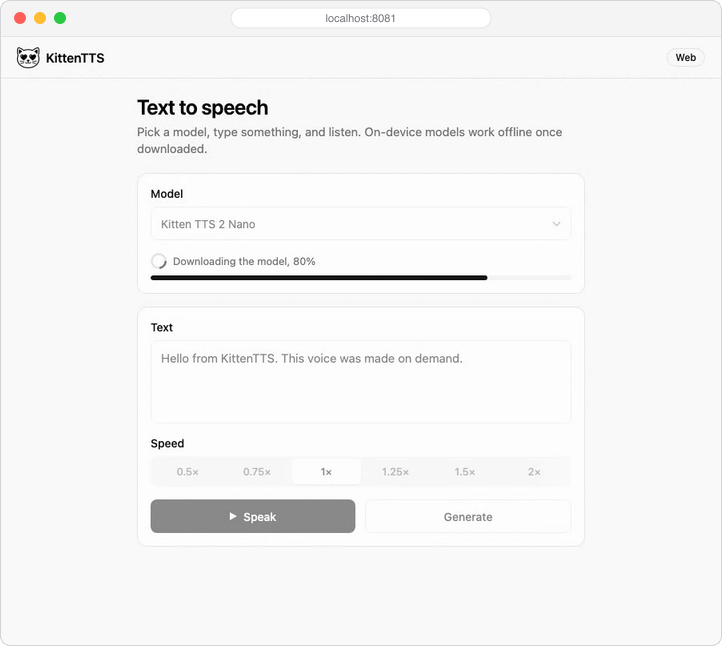

# KittenTTS React Native

<p align="center">
  
</p>

<p align="center">
  On-device text-to-speech for React Native and React Native Web.
  <br />
  Generate speech on iOS, Android, and web without sending text to a cloud TTS API.
</p>

<p align="center">
  <a href="https://huggingface.co/spaces/KittenML/KittenTTS-Demo"></a>
  <a href="https://discord.com/invite/VJ86W4SURW"></a>
  <a href="https://kittenml.com"></a>
  <a href="https://github.com/KittenML/kittentts-react-native"></a>
  <a href="LICENSE"></a>
  
</p>

> Developer preview. APIs may change between releases.

> Expo Go will not work for native iOS/Android. KittenTTS uses native modules
> (`onnxruntime-react-native` and `react-native-fs`) on mobile, so Expo apps
> need a development build or a prebuilt native project. Web builds use
> `onnxruntime-web` and browser storage instead.

> React Native Web loads a pinned ONNX Runtime Web script and WASM assets from
> jsDelivr by default. For production apps that need CDN independence or stricter
> supply-chain controls, self-host those ONNX Runtime assets and set
> `ortWasmPath`.

## See It In Action

<p align="center">
  
  
</p>

<p align="center">
  <strong>Device: iOS</strong> · Expo example &nbsp;&nbsp;&nbsp; <strong>Device: Android</strong> · Word timings
</p>

<p align="center">
  
</p>

<p align="center">
  <strong>Web</strong> · Browser example
</p>

---

## What Is KittenTTS React Native?

KittenTTS React Native lets you add local speech synthesis to a mobile app:

- **Text-to-speech** - neural voice synthesis from plain text.
- **On-device inference** - powered by KittenTTS and ONNX Runtime.
- **Private by default** - no cloud TTS request after assets are available.
- **Offline-ready** - download once into the device cache, or bundle assets into
  the native app.
- **App-friendly output** - play audio directly, save WAV data, or use generated
  word timings for read-aloud UI.
- **Three engines, one API** - the 0.8 models and the multilingual Kitten TTS 2
  Nano, Pico and Mini on the device, and Kitten TTS 2 Cloud (voice cloning,
  expression tags) through the Kitten API. `KittenTTS.create()` picks the engine
  from the model name, as the Python package does.

With the on-device models: no cloud, no API key, no text leaving the device for
speech generation.

---

## SDK

| Runtime | Status | Docs |
| --- | --- | --- |
| React Native iOS | Developer preview | [Getting started](docs/getting-started.md) |
| React Native Android | Developer preview | [Getting started](docs/getting-started.md) |
| React Native Web | Developer preview | [Getting started](docs/getting-started.md#web) |
| Expo development build | Supported | [Expo setup](docs/getting-started.md#expo-development-build) |
| Expo Go | Not supported | [Why not?](docs/troubleshooting.md#expo-go-fails) |

Install:

```bash
npm install @kittentts/react-native
```

---

## Quick Start

Install the SDK:

```bash
npm install @kittentts/react-native
```

Generate a WAV in memory:

```tsx
import { KittenTTS } from '@kittentts/react-native';

const tts = await KittenTTS.create(undefined, (progress) => {
  console.log(`setup ${Math.round(progress * 100)}%`);
});

const result = await tts.generate('Hello from KittenTTS on React Native.');

console.log(result.duration);
console.log(result.wavBase64());

await tts.dispose();
```

Play audio through Expo Audio:

```tsx
import * as ExpoAudio from 'expo-audio';
import { KittenTTS, createExpoAudioPlayer } from '@kittentts/react-native';

const tts = await KittenTTS.create({
  player: createExpoAudioPlayer(ExpoAudio),
});

await tts.speak('This voice is generated on the device.');
```

Play audio in a web build:

```tsx
import {
  KittenTTS,
  createBrowserAudioPlayer,
} from '@kittentts/react-native';

const tts = await KittenTTS.create({
  player: createBrowserAudioPlayer(),
});

await tts.speak('This voice is generated in the browser.');
```

[Full getting started guide →](docs/getting-started.md)

---

## Kitten TTS 2 Cloud

Kitten TTS 2 Cloud, the largest Kitten TTS 2, is too large to run inside an app,
so the SDK runs it on the hosted [Kitten API](https://docs.kittenml.com/). It
loads through the same `KittenTTS.create()` and answers the same calls, like
`KittenTTS("KittenML/kitten-tts-2")` in the Python package (`'kitten-tts-2'`
works here too):

```tsx
import * as ExpoAudio from 'expo-audio';
import { KittenTTS, createExpoAudioPlayer } from '@kittentts/react-native';

const tts = await KittenTTS.create({
  model: 'kitten-tts-2-cloud',
  apiKey: KITTENML_API_KEY, // ship with baseUrl and your own backend instead
  player: createExpoAudioPlayer(ExpoAudio),
});

await tts.speak('Hi! umm.. how are you, I guess?', 'bella_en');

const cloned = await tts.generate('This sentence uses my voice.', {
  reference: recordingUri,
  preset: 'stable',
});

for await (const chunk of tts.generateStreaming(longText, 'bella_en')) {
  await tts.play(chunk);
}
```

`tts.availableVoices` lists the voice IDs. The text you pass is sent to the API
and billed to your KittenML account. With an `apiKey` (or `baseUrl`), Nano, Pico
and Mini run on the API too: `KittenTTS.create({ model: 'kitten-tts-2-nano', apiKey })`.

[Kitten TTS 2 Cloud guide →](docs/guides/kitten-api.md)

---

## Expo Setup

Expo Go cannot load the native ONNX Runtime and filesystem modules used by this
SDK. Use a development build:

```bash
npm install @kittentts/react-native
npx expo install expo-audio expo-dev-client
npx expo prebuild
npx expo run:ios
```

For Android:

```bash
npx expo run:android
```

After the development build is installed:

```bash
npx expo start --dev-client
```

If the app opens in Expo Go, stop it and run `npx expo run:ios` or
`npx expo run:android` again.

---

## Sample Apps

- [`examples/ExpoExample`](examples/ExpoExample) - Expo (SDK 58) app with every
  engine: the 0.8 models, Kitten TTS 2 Nano, Pico and Mini on the device, and the
  Kitten TTS 2 Cloud models. Runs on iOS, Android and the web.
- [`examples/BareRNExample`](examples/BareRNExample) - the same app in a bare
  React Native (0.81) project.
- [`examples/ExpoWordTimingsExample`](examples/ExpoWordTimingsExample) - word
  highlighting with generated timings, with 0.8 or Kitten TTS 2 models.
- [`examples/OfflineBundledAssetsExample`](examples/OfflineBundledAssetsExample) -
  shipping the model files inside the app.

To run an example against this checkout of the SDK (or before a new version is on
npm), install it with `npm run example:install -- ExpoExample` from the
repository root.

---

## Features

- [On-device TTS inference](docs/getting-started.md) on iOS, Android, and web.
- [Kitten TTS 2 Nano, Pico and Mini](docs/guides/kitten-tts-2-tiny.md) on device, in 8 languages (Mini 16), with the Python package's phonemes.
- [Model download and cache](docs/reference/api.md#cache-methods) with progress callbacks.
- [Bundled offline assets](docs/guides/offline-assets.md) for apps that cannot depend on a first-run download.
- [Expo development builds](docs/getting-started.md#expo-development-build); Expo Go is [not supported](docs/troubleshooting.md#expo-go-fails).
- [Playback helpers](docs/guides/playback.md) for Expo Audio, React Native Sound, and custom audio layers.
- [WAV output](docs/reference/api.md#kittenttsresult) as raw PCM samples, bytes, or base64.
- [Word timings](docs/guides/word-timings.md) for read-aloud highlighting.
- [Streaming generation](docs/reference/api.md#ttsgeneratestreamingtext-voice-speed) for longer text.
- [Kitten TTS 2 Cloud](docs/guides/kitten-api.md) through the Kitten API, with voice cloning, and Nano, Pico and Mini in the cloud.

---

## Supported Models

Start with `NanoInt8` for the smallest download. Use larger models when quality
matters more than size.

| Model | Enum | Parameters | Approx download | Use case |
| --- | --- | --- | --- | --- |
| Nano int8 | `KittenModel.NanoInt8` | 15M | 28 MB | Smallest app/download size |
| Nano fp32 | `KittenModel.Nano` | 15M | 59 MB | Nano quality without quantization |
| Micro | `KittenModel.Micro` | 40M | 44 MB | Better quality, still compact |
| Mini | `KittenModel.Mini` | 80M | 83 MB | Highest quality option |

[Models and voices →](docs/reference/models.md)

### Kitten TTS 2 Nano, Pico and Mini

The small multilingual Kitten TTS 2 models (8 languages; Mini 16, Japanese
included) run on device too, with the same voices and the same phonemes as the
Python package. They need React Native 0.75 or newer (Hermes).

```tsx
const tts = await KittenTTS.create({ model: 'kitten-tts-2-nano', languages: ['en', 'de'] });
await tts.generate('Guten Morgen.', { voice: 'Paul' });
```

[Kitten TTS 2 Nano, Pico and Mini →](docs/guides/kitten-tts-2-tiny.md) (sizes,
languages, speed)

## Voices

```text
Bella, Jasper, Luna, Bruno, Rosie, Hugo, Kiki, Leo
```

```tsx
await tts.speak('Luna speaking.', KittenVoice.Luna);
await tts.speak('Slower Bruno speaking.', KittenVoice.Bruno, 0.85);
```

---

## Docs

- [Docs overview](docs/README.md)
- [Getting started](docs/getting-started.md)
- [Playback](docs/guides/playback.md)
- [Kitten TTS 2 Cloud](docs/guides/kitten-api.md)
- [Bundled offline assets](docs/guides/offline-assets.md)
- [Word timings](docs/guides/word-timings.md)
- [Kitten TTS 2 Nano, Pico and Mini](docs/guides/kitten-tts-2-tiny.md)
- [Models and voices](docs/reference/models.md)
- [API reference](docs/reference/api.md)
- [Troubleshooting](docs/troubleshooting.md)

Tutorials:

- [Simple TTS app on macOS](docs/tutorials/simple-tts/mac.md)
- [Simple TTS app on Windows](docs/tutorials/simple-tts/windows.md)
- [Reader app on macOS](docs/tutorials/epub-reader/mac.md)
- [Reader app on Windows](docs/tutorials/epub-reader/windows.md)

---

## System Requirements

- React Native `>= 0.72` (`>= 0.75` for Kitten TTS 2 Nano, Pico and Mini)
- iOS `15.1+`
- Android API `24+`
- Node.js `20+` recommended for examples

Runtime dependencies installed by the SDK:

- `onnxruntime-react-native`
- `react-native-fs`
- `pako`

Audio playback is optional. Use `expo-audio`, `react-native-sound`, or a custom
player.

---

## Roadmap

- Improve streaming and playback queue primitives.
- Add more reader-app helpers around pause, resume, and seek state.
- Continue tracking ONNX Runtime compatibility across React Native and Expo
  releases.
- Support future KittenTTS model releases as they become available.

Need something specific? [Open an issue](https://github.com/KittenML/kittentts-react-native/issues).

---

## Community And Support

- Website: [kittenml.com](https://kittenml.com/)
- Repository: [KittenML/kittentts-react-native](https://github.com/KittenML/kittentts-react-native)
- Discord: [Join the community](https://discord.com/invite/VJ86W4SURW)
- Demo: [Hugging Face Spaces](https://huggingface.co/spaces/KittenML/KittenTTS-Demo)
- Issues: [GitHub Issues](https://github.com/KittenML/kittentts-react-native/issues)
- Commercial support: [contact form](https://docs.google.com/forms/d/e/1FAIpQLSc49erSr7jmh3H2yeqH4oZyRRuXm0ROuQdOgWguTzx6SMdUnQ/viewform?usp=preview)

## License

Apache 2.0. See [LICENSE](./LICENSE).

The package also ships espeak-ng compiled to JavaScript, which is
GPL-3.0-or-later, for the Kitten TTS 2 languages other than English and
Japanese. React Native bundles it
into every app that uses this package (it runs only for those languages), so an
app built with it includes GPL-3.0-or-later code. See [THIRD_PARTY_NOTICES.md](./THIRD_PARTY_NOTICES.md).
